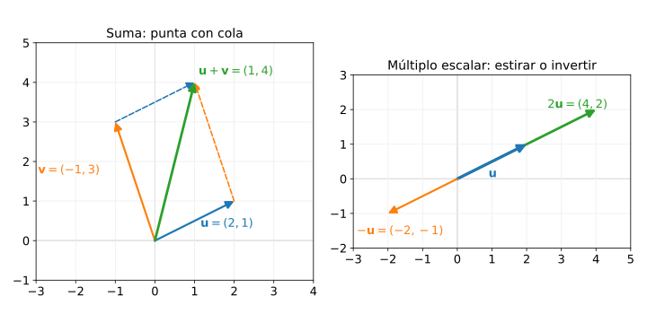
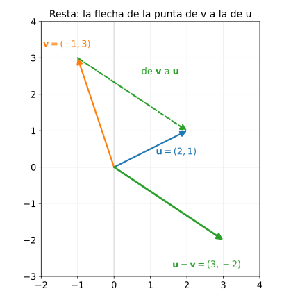
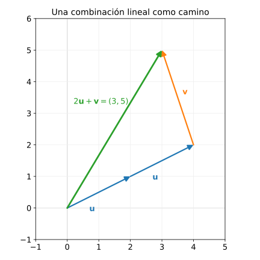
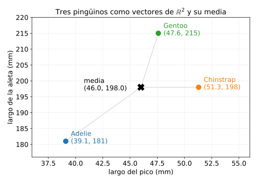

## Objetivos de aprendizaje

Al terminar esta lección podrás:

- **Representar** una tabla de datos como una matriz $X$ de forma $(n, p)$ y **nombrar** cada fila como una observación en $\mathbb{R}^p$ y cada columna como una variable en $\mathbb{R}^n$. *(Comprender)*
- **Calcular** a mano sumas, múltiplos escalares y combinaciones lineales de vectores, componente a componente, y **dibujarlas** en $\mathbb{R}^2$. *(Aplicar)*
- **Escribir** el vector media de $n$ observaciones como una combinación lineal y **calcularlo** a mano y con NumPy. *(Aplicar)*
- **Usar** arreglos de NumPy (forma, filas, columnas, operaciones vectorizadas) para hacer y verificar estos cálculos sin ciclos. *(Aplicar)*
- **Juzgar** si una operación entre vectores tiene sentido: misma dimensión y unidades compatibles. *(Evaluar)*

> **Dónde encaja:** es la primera lección del curso. La L02 usa estos vectores para medir: el producto punto, las normas y las distancias.

> **Práctica:** [Lab — Los datos como vectores](l01_lab_vectores_datos.md) ·
> [](https://colab.research.google.com/github///blob//u01_vectores/l01_lab_vectores_datos.ipynb) ·
> [Ejercicios resueltos](l01_exercises_vectores_datos.qmd)

> **En clase y después.** La clase recorre las secciones de la 1 a la 5 y "Cuándo tiene sentido
> una operación". Lo marcado **Para leer después** amplía la lección; léelo antes del
> laboratorio. Los errores comunes y los ejercicios son para repasar.

## Por qué importa

En CDAT 4001 cargaste la tabla de los pingüinos de Palmer y escribiste `df.mean()`. Salió una
fila de cuatro números: el largo del pico, la profundidad del pico, el largo de la aleta y la
masa corporal "promedio". ¿Qué pingüino es ese? Ninguno de los 342 medidos tiene exactamente esas
medidas. Para decir qué calculó `df.mean()` hay que mirar cada pingüino como un **vector** (*vector*) y
la media como una **combinación lineal** (*linear combination*) de todos ellos. Esa es la idea de esta lección, y la base
de todo el curso: las distancias, las proyecciones, la regresión y el PCA son operaciones con
estos vectores.

## 1. Vectores: listas ordenadas de números

Un **vector** de $\mathbb{R}^n$ es una lista ordenada de $n$ números reales, sus
**componentes** (*components* o *entries*). Lo escribimos en negrita:

$$
\mathbf{x} = (x_1, x_2, \ldots, x_n), \qquad x_i \in \mathbb{R}.
$$

El orden importa: $(2, 1)$ y $(1, 2)$ son vectores distintos. Dos vectores son iguales cuando
tienen la misma dimensión y coinciden componente a componente.

En $\mathbb{R}^2$ un vector tiene dos lecturas, y las usaremos ambas:

- un **punto** del plano, con coordenadas $(x_1, x_2)$;
- una **flecha** que sale del origen y termina en ese punto.

Un número real suelto, como $3$ o $-0.5$, se llama **escalar** (*scalar*) para distinguirlo de
un vector.

## 2. Los datos como vectores

Tomemos tres pingüinos de la tabla, uno de cada especie, y dos de sus medidas:

| Pingüino | Largo del pico (mm) | Largo de la aleta (mm) |
|---|---:|---:|
| Adelie | 39.1 | 181 |
| Chinstrap | 51.3 | 198 |
| Gentoo | 47.6 | 215 |

La tabla se lee de dos maneras:

- **Cada fila es una observación** (*observation*): un pingüino es un vector de $\mathbb{R}^2$.
  El Adelie es $\mathbf{x}_1 = (39.1, 181)$, el Chinstrap $\mathbf{x}_2 = (51.3, 198)$ y el
  Gentoo $\mathbf{x}_3 = (47.6, 215)$.
- **Cada columna es una variable** (*variable* o *feature*): el largo del pico de los tres
  pingüinos es un vector de $\mathbb{R}^3$, $(39.1, 51.3, 47.6)$.

La tabla entera es la **matriz de datos** (*data matrix*) $X$. Con $n$ observaciones y $p$
variables, $X$ tiene **forma** (*shape*) $(n, p)$: $n$ filas, cada una en $\mathbb{R}^p$, y $p$
columnas, cada una en $\mathbb{R}^n$. La tabla de arriba tiene forma $(3, 2)$. La tabla completa
del laboratorio, con los 342 pingüinos que tienen las cuatro medidas, tiene forma $(342, 4)$:
cada pingüino es un vector de $\mathbb{R}^4$ y cada variable un vector de $\mathbb{R}^{342}$.

::: {.callout-note collapse="true"}
## Para leer después: textos y redes también son vectores

**Un texto.** Fija una lista de palabras, el *vocabulario*, por ejemplo
("vector", "datos", "matriz", "suma"). Un texto se vuelve el vector que cuenta cuántas veces
aparece cada palabra. "una matriz de datos tiene un vector de datos por fila" es
$(1, 2, 1, 0)$: una vez "vector", dos veces "datos", una vez "matriz", ninguna "suma". Una
colección de textos es entonces una matriz de datos: una fila por texto, una columna por
palabra. En el laboratorio verás qué significa sumar dos de estos vectores.

**Una red.** En una red de amistades, la fila de una persona puede ser el vector que tiene un
$1$ en la posición de cada amigo y un $0$ en las demás. Las filas juntas forman la *matriz de
adyacencia*, que estudiaremos en la Unidad II.
:::

## 3. Suma y multiplicación por escalar

Las dos operaciones básicas, la **suma de vectores** (*vector addition*) y la **multiplicación
por escalar** (*scalar multiplication*), se hacen **componente a componente**. Para
$\mathbf{u} = (u_1, \ldots, u_n)$, $\mathbf{v} = (v_1, \ldots, v_n)$ y un escalar $c$:

$$
\mathbf{u} + \mathbf{v} = (u_1 + v_1, \ldots, u_n + v_n), \qquad
c\,\mathbf{u} = (c\,u_1, \ldots, c\,u_n).
$$

La suma solo está definida entre vectores de la **misma dimensión**.

**Ejemplo.** Con $\mathbf{u} = (2, 1)$ y $\mathbf{v} = (-1, 3)$, cada componente de
$\mathbf{u} + \mathbf{v}$ es una suma de números:

$$
\begin{aligned}
2 + (-1) &= 1 && \text{primera componente} \\
1 + 3 &= 4 && \text{segunda componente}
\end{aligned}
$$

así que $\mathbf{u} + \mathbf{v} = (1, 4)$. Del mismo modo, $2\mathbf{u} = (4, 2)$ y
$-\mathbf{u} = (-1)\mathbf{u} = (-2, -1)$.

{#fig-suma-escalar width="100%" fig-alt="A la izquierda, las flechas u = (2, 1) y v = (-1, 3) salen del origen; copias punteadas forman un paralelogramo cuya diagonal es u + v = (1, 4). A la derecha, u, la flecha el doble de larga 2u = (4, 2) y la flecha opuesta -u = (-2, -1), todas sobre la misma recta."}

**Cómo leer la figura.** A la izquierda, sumar es poner una flecha a continuación de la otra
("punta con cola"): seguir $\mathbf{u}$ y luego $\mathbf{v}$ lleva al mismo punto que seguir
$\mathbf{v}$ y luego $\mathbf{u}$. Por eso $\mathbf{u} + \mathbf{v}$ es la diagonal del
paralelogramo y $\mathbf{u} + \mathbf{v} = \mathbf{v} + \mathbf{u}$. A la derecha, multiplicar
por un escalar **no cambia la recta** de la flecha: $2\mathbf{u}$ la estira al doble y
$-\mathbf{u}$ la invierte.

**La resta.** Restar es sumar el opuesto: $\mathbf{u} - \mathbf{v} = \mathbf{u} + (-1)\mathbf{v}$,
también componente a componente. Con los mismos $\mathbf{u} = (2, 1)$ y $\mathbf{v} = (-1, 3)$:

$$
\begin{aligned}
2 - (-1) &= 3 && \text{primera componente} \\
1 - 3 &= -2 && \text{segunda componente}
\end{aligned}
$$

así que $\mathbf{u} - \mathbf{v} = (3, -2)$.

{#fig-resta width="55%" fig-alt="Las flechas u = (2, 1) y v = (-1, 3) salen del origen. Una flecha verde punteada va de la punta de v, (-1, 3), a la punta de u, (2, 1). Una flecha verde sólida, paralela a ella y del mismo largo, va del origen a (3, -2) y lleva la etiqueta u - v = (3, -2)."}

**Cómo leer la figura.** Como $\mathbf{v} + (\mathbf{u} - \mathbf{v}) = \mathbf{u}$, la resta es
la flecha que, puesta a continuación de $\mathbf{v}$, llega a $\mathbf{u}$: la flecha punteada,
**de la punta de $\mathbf{v}$ a la punta de $\mathbf{u}$**. Trasladada al origen, es la flecha
sólida $(3, -2)$. Si $\mathbf{u}$ y $\mathbf{v}$ son dos puntos, $\mathbf{u} - \mathbf{v}$ es el
desplazamiento que lleva del uno al otro: en la L02 su longitud será la distancia entre ellos.

::: {.callout-note collapse="true"}
## Para leer después: las propiedades de las operaciones

Como cada componente es una operación entre números reales, las operaciones heredan sus
propiedades. Para vectores $\mathbf{u}, \mathbf{v}, \mathbf{w}$ de $\mathbb{R}^n$ y escalares
$a, b$:

| Propiedad | Igualdad |
|---|---|
| Conmutativa | $\mathbf{u} + \mathbf{v} = \mathbf{v} + \mathbf{u}$ |
| Asociativa | $(\mathbf{u} + \mathbf{v}) + \mathbf{w} = \mathbf{u} + (\mathbf{v} + \mathbf{w})$ |
| Vector cero | $\mathbf{u} + \mathbf{0} = \mathbf{u}$, con $\mathbf{0} = (0, \ldots, 0)$ |
| Opuesto | $\mathbf{u} + (-\mathbf{u}) = \mathbf{0}$ |
| Distributivas | $a(\mathbf{u} + \mathbf{v}) = a\mathbf{u} + a\mathbf{v}$ y $(a + b)\mathbf{u} = a\mathbf{u} + b\mathbf{u}$ |
| Escalares | $a(b\,\mathbf{u}) = (ab)\,\mathbf{u}$ y $1\,\mathbf{u} = \mathbf{u}$ |

Cada una se demuestra componente a componente. Por ejemplo, la componente $i$ de
$\mathbf{u} + \mathbf{v}$ es $u_i + v_i$, la de $\mathbf{v} + \mathbf{u}$ es $v_i + u_i$, y
esos números son iguales porque la suma de reales es conmutativa. En la Unidad III estas
propiedades se convierten en la definición de *espacio vectorial*.
:::

## 4. Combinaciones lineales

Una **combinación lineal** de los vectores
$\mathbf{v}_1, \ldots, \mathbf{v}_k$ es una suma de múltiplos escalares de ellos:

$$
c_1\mathbf{v}_1 + c_2\mathbf{v}_2 + \cdots + c_k\mathbf{v}_k,
$$

donde los **coeficientes** $c_1, \ldots, c_k$ son escalares cualesquiera. Se calcula
componente a componente: cada componente del resultado combina las mismas componentes de los
vectores, con los mismos coeficientes.

**Ejemplo.** Con los mismos $\mathbf{u} = (2, 1)$ y $\mathbf{v} = (-1, 3)$:

$$
\begin{aligned}
2(2) + (-1) &= 3 && \text{primera componente} \\
2(1) + 3 &= 5 && \text{segunda componente}
\end{aligned}
$$

así que $2\mathbf{u} + \mathbf{v} = (3, 5)$.

{#fig-combinacion width="55%" fig-alt="Desde el origen, dos flechas u seguidas llegan a (4, 2); una flecha v desde ahí llega a (3, 5). Una flecha verde va directo del origen a (3, 5) y lleva la etiqueta 2u + v = (3, 5)."}

**Cómo leer la figura.** Una combinación lineal es un camino: se avanza $2$ veces en la
dirección de $\mathbf{u}$ y $1$ vez en la de $\mathbf{v}$, y el vector resultado va del origen
al final del camino. Otros coeficientes dan otros puntos. La pregunta inversa, si un punto dado
se alcanza con alguna combinación de $\mathbf{u}$ y $\mathbf{v}$ y con qué coeficientes, es un
sistema de ecuaciones: es el tema de la Unidad II.

## 5. El vector media es una combinación lineal

La **media** de $n$ observaciones $\mathbf{x}_1, \ldots, \mathbf{x}_n$ es el **vector media**
(*mean vector*): la media de cada variable, componente a componente. Al escribirla resulta una
combinación lineal con todos los coeficientes iguales a $1/n$:

$$
\bar{\mathbf{x}} = \frac{1}{n}(\mathbf{x}_1 + \cdots + \mathbf{x}_n)
= \frac{1}{n}\mathbf{x}_1 + \frac{1}{n}\mathbf{x}_2 + \cdots + \frac{1}{n}\mathbf{x}_n.
$$

**Ejemplo.** Para los tres pingüinos de la sección 2, cada coeficiente es $1/3$. Componente a
componente:

$$
\begin{aligned}
\frac{1}{3}(39.1 + 51.3 + 47.6) &= \frac{1}{3}(138) \\
&= 46
\end{aligned}
$$

$$
\begin{aligned}
\frac{1}{3}(181 + 198 + 215) &= \frac{1}{3}(594) \\
&= 198
\end{aligned}
$$

El vector media es $\bar{\mathbf{x}} = (46.0, 198.0)$.

{#fig-media width="90%" fig-alt="Tres puntos: Adelie en (39.1, 181), Chinstrap en (51.3, 198) y Gentoo en (47.6, 215). Una X negra marca la media en (46.0, 198.0), unida a cada punto por una línea gris."}

**Cómo leer la figura.** Con datos, cada observación se dibuja como un **punto**, no como una
flecha: los datos quedan lejos del origen, y cientos de flechas que salieran de $(0, 0)$ se
amontonarían unas sobre otras. La media es el "centro" de los tres puntos: en cada eje es el
promedio de sus coordenadas. No es ninguno de los tres pingüinos; es una combinación de ellos. Eso
responde la pregunta del principio: el pingüino "promedio" de `df.mean()` es el vector media,
un punto calculado, no un animal medido.

**Con los 342 pingüinos.** La misma fórmula, con $n = 342$ y las cuatro variables, es lo que
calcula `X.mean(axis=0)` en el laboratorio. El argumento `axis=0` dice que se promedia **a lo
largo de las filas**, hacia abajo en cada columna: sale una media por variable, un vector de
$\mathbb{R}^4$. (Sin él, NumPy promediaría todos los números de la tabla en uno solo.)

```python
media = X.mean(axis=0)   # la media de cada columna: el vector media
print("vector media:", np.round(media, 1))
```

~~~text
vector media: [  43.9   17.2  200.9 4201.8]
~~~

Es decir, un pico de 43.9 mm de largo y 17.2 mm de profundidad, una aleta de 200.9 mm y una
masa de 4201.8 g. En el laboratorio verificas que es exactamente la combinación lineal
$\frac{1}{342}\mathbf{x}_1 + \cdots + \frac{1}{342}\mathbf{x}_{342}$, y calculas la media de cada
especie.

## Cuándo tiene sentido una operación

- **Misma dimensión.** $(1, 2) + (3, 4, 5)$ no está definido: no hay una tercera componente
  que sumarle a $(1, 2)$.
- **Unidades compatibles, componente a componente.** Sumar dos pingüinos componente a
  componente suma milímetros con milímetros y gramos con gramos: tiene sentido (es el primer
  paso de la media). Sumar el largo del pico (mm) con la masa (g) del mismo pingüino no tiene
  sentido: el número sale, pero no mide nada.
- **Un múltiplo escalar puede cambiar unidades.** Multiplicar la columna de la masa por
  $0.001$ la pasa de gramos a kilogramos: $3750$ g se vuelven $3.75$ kg. Es la misma variable,
  en otra escala.

## Para leer después: los vectores en NumPy

En Python, un vector es un **arreglo** (*array*) de NumPy y la matriz de datos un arreglo de dos
dimensiones; su atributo `shape` es la forma $(n, p)$. `X[0]` es la primera fila (una
observación) y `X[:, 2]` la tercera columna (una variable).

Las operaciones de NumPy son **vectorizadas** (*vectorized*): `u + v` y `2 * u` actúan
componente a componente sin que escribas un ciclo. En el laboratorio comparas las dos formas
con vectores de un millón de componentes: dan el mismo resultado y la vectorizada es mucho más
rápida. El tiempo exacto depende de la máquina, así que el laboratorio comprueba la diferencia
en vez de imprimir el tiempo.

## Errores comunes

- **Multiplicar solo una componente.** $3(2, -1)$ es $(6, -3)$, no $(6, -1)$: el escalar
  multiplica **todas** las componentes.
- **Confundir filas y columnas.** En $X$ de forma $(342, 4)$, una fila (un pingüino) tiene 4
  componentes y una columna (una variable) tiene 342.
- **Dividir entre el $n$ equivocado.** La tabla original tiene 344 filas, pero 2 pingüinos no
  tienen medidas. La media de las 342 filas completas se divide entre 342, no entre 344.
- **Rellenar con ceros para sumar dimensiones distintas.** $(1, 2) + (3, 4, 5)$ no es
  $(4, 6, 5)$: la suma no está definida, y añadir una componente $0$ inventa un dato.

## Pregunta frecuente

**¿Por qué no basta con `df.mean()`?** Basta para obtener el número. Esta lección dice qué es
ese número: una combinación lineal de las observaciones. Esa lectura es la que usa el resto del
curso: en la L04 se centran los datos restándoles el vector media, y en la Unidad VII el PCA
parte de esos datos centrados.

## Ejercicios

- La [página de ejercicios](l01_exercises_vectores_datos.qmd) tiene más operaciones,
  combinaciones lineales y vectores media resueltos paso a paso, una primera demostración y los
  casos especiales.
- En el [laboratorio](l01_lab_vectores_datos.md) haces los cálculos con NumPy sobre los 342
  pingüinos y llevas la idea a otro tipo de datos: textos convertidos en vectores.

## Resumen

| Notación | Qué significa | NumPy |
|---|---|---|
| $\mathbf{x} = (x_1, \ldots, x_n)$ | un vector de $\mathbb{R}^n$: un punto, o una flecha desde el origen | `np.array([2, 1])` |
| $X$, de forma $(n, p)$ | la matriz de datos: una fila por observación, una columna por variable | `X.shape`, `X[0]`, `X[:, 2]` |
| $\mathbf{u} + \mathbf{v}$ | componente a componente; la diagonal del paralelogramo (punta con cola) | `u + v` |
| $c\,\mathbf{u}$ | estira, encoge o invierte la flecha, sin cambiar su recta | `c * u` |
| $\mathbf{u} - \mathbf{v}$ | la flecha de la punta de $\mathbf{v}$ a la punta de $\mathbf{u}$ | `u - v` |
| $c_1\mathbf{v}_1 + \cdots + c_k\mathbf{v}_k$ | una combinación lineal: un camino de flechas | `2 * u + v` |
| $\bar{\mathbf{x}} = \frac{1}{n}(\mathbf{x}_1 + \cdots + \mathbf{x}_n)$ | el vector media: la combinación lineal con coeficientes $1/n$, el centro de los puntos | `X.mean(axis=0)` |

## Ideas clave

- Una matriz de datos $X$ de forma $(n, p)$ tiene una fila por observación, un vector de $\mathbb{R}^p$, y una columna por variable, un vector de $\mathbb{R}^n$.
- Una combinación lineal $c_1\mathbf{v}_1 + \cdots + c_k\mathbf{v}_k$ se calcula componente a componente: cada componente del resultado combina las mismas componentes de los vectores.
- El vector media de $n$ observaciones es su combinación lineal con todos los coeficientes iguales a $1/n$.

## Lecturas adicionales

- **Texto del curso:** Boyd y Vandenberghe, *Introduction to Applied Linear Algebra*, capítulo 1
  (vectores, suma, múltiplo escalar, combinaciones lineales). Gratis en el sitio de los autores.
- **Texto del curso:** Lay, Lay y McDonald, *Álgebra lineal y sus aplicaciones*, sección 1.3
  (ecuaciones vectoriales).
- **Video:** 3Blue1Brown, *Essence of Linear Algebra*, capítulo 1 (qué es un vector).
- **Documentación:** NumPy, *NumPy: the absolute basics for beginners* (arreglos y su forma).
