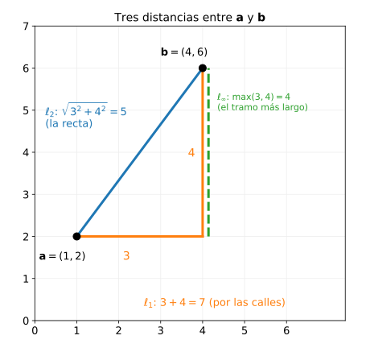
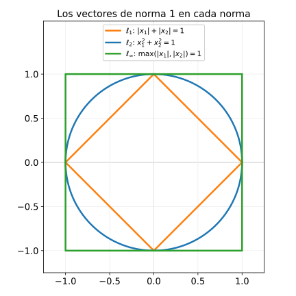

## Objetivos de aprendizaje

Al terminar esta lección podrás:

- **Calcular** productos punto a mano y con NumPy, y **usar** que $\mathbf{v} \cdot \mathbf{v} = \|\mathbf{v}\|^2$ y las propiedades del producto punto. *(Aplicar)*
- **Calcular** las normas $\ell_1$, $\ell_2$ y $\ell_\infty$ de un vector y las distancias entre dos vectores, y **normalizar** un vector. *(Aplicar)*
- **Demostrar** propiedades básicas a partir de las definiciones, como $\|c\,\mathbf{v}\| = |c|\,\|\mathbf{v}\|$. *(Analizar)*
- **Evaluar** cómo las unidades de las variables deciden la distancia entre observaciones, comparando el vecino más cercano antes y después de un cambio de unidades. *(Evaluar)*
- **Escoger** la norma que responde una pregunta (la diferencia total, en línea recta o la peor) y **justificar** la elección. *(Evaluar)*

> **Dónde encaja:** la L01 convirtió los datos en vectores. Esta lección los mide: cuánto
> mide un vector y qué tan lejos están dos. La L03 usa el producto punto para medir ángulos, y la
> L04 resuelve el problema de unidades que aparece al final de esta.

> **Práctica:** [Lab — Producto punto, normas y distancias](l02_lab_producto_punto_normas.md) ·
> [](https://colab.research.google.com/github///blob//u01_vectores/l02_lab_producto_punto_normas.ipynb) ·
> [Ejercicios resueltos](l02_exercises_producto_punto_normas.qmd)

> **En clase y después.** La clase recorre las secciones de la 1 a la 5. Lo marcado **Para leer
> después** amplía la lección; léelo antes del laboratorio. Los errores comunes y los ejercicios
> son para repasar.

## Por qué importa

¿Qué pingüino se parece más a este? Para contestar hace falta una **distancia** (*distance*)
entre vectores, y una distancia es la **norma** (*norm*) de una diferencia. En CDAT 4001
calculaste distancias con `np.linalg.norm`; esta lección dice qué calcula esa función, y muestra
algo que su resultado esconde: con los pingüinos tal como vienen en el archivo, la respuesta
depende casi solo de la masa. Basta con pasar la masa de gramos a kilogramos, un múltiplo
escalar de una columna (L01), para que el pingüino más parecido cambie.

## 1. El producto punto

El **producto punto** (*dot product*) de dos vectores de $\mathbb{R}^n$ multiplica las
componentes que se corresponden y suma los resultados:

$$
\mathbf{u} \cdot \mathbf{v} = u_1 v_1 + u_2 v_2 + \cdots + u_n v_n .
$$

El resultado es un **número**, no un vector. Solo está definido entre vectores de la misma
dimensión.

**Ejemplo.** Con $\mathbf{u} = (3, 4)$ y $\mathbf{v} = (2, -1)$:

$$
\begin{aligned}
\mathbf{u} \cdot \mathbf{v} &= 3(2) + 4(-1) \\
&= 6 - 4 \\
&= 2
\end{aligned}
$$

**Una suma ponderada.** En una cafetería compras 2 cafés a \$1.50 y 3 panes a \$2.00. Con el
vector de cantidades $\mathbf{q} = (2, 3)$ y el de precios $\mathbf{p} = (1.50, 2.00)$, el
total es el producto punto:

$$
\begin{aligned}
\mathbf{q} \cdot \mathbf{p} &= 2(1.50) + 3(2.00) \\
&= 9
\end{aligned}
$$

Cada componente de un vector pesa según la componente correspondiente del otro. Con el vector
de unos, $\mathbf{1} = (1, \ldots, 1)$, el producto punto suma las componentes:
$\mathbf{1} \cdot \mathbf{x} = x_1 + \cdots + x_n$. Así que la media de una variable de la L01 es
también un producto punto: $\frac{1}{n}\,\mathbf{1} \cdot \mathbf{x}$.

**Propiedades.** Para vectores $\mathbf{u}, \mathbf{v}, \mathbf{w}$ de $\mathbb{R}^n$ y un
escalar $c$:

| Propiedad | Igualdad |
|---|---|
| Simétrica | $\mathbf{u} \cdot \mathbf{v} = \mathbf{v} \cdot \mathbf{u}$ |
| Distributiva | $\mathbf{u} \cdot (\mathbf{v} + \mathbf{w}) = \mathbf{u} \cdot \mathbf{v} + \mathbf{u} \cdot \mathbf{w}$ |
| Homogénea | $(c\,\mathbf{u}) \cdot \mathbf{v} = c\,(\mathbf{u} \cdot \mathbf{v})$ |
| Positiva | $\mathbf{v} \cdot \mathbf{v} \ge 0$, y es $0$ solo si $\mathbf{v} = \mathbf{0}$ |

Cada una sale de las componentes. Por ejemplo, $\mathbf{v} \cdot \mathbf{u} = 2(3) + (-1)(4)$
tiene los mismos productos que $\mathbf{u} \cdot \mathbf{v}$ en otro orden, y también da $2$. La
última propiedad vale porque $\mathbf{v} \cdot \mathbf{v} = v_1^2 + \cdots + v_n^2$ es una suma
de cuadrados. En los ejercicios demuestras las demás.

## 2. La norma euclidiana

¿Cuánto mide una flecha? En $\mathbb{R}^2$ lo dice el teorema de Pitágoras: la flecha
$\mathbf{v} = (v_1, v_2)$ es la hipotenusa de un triángulo rectángulo con catetos $|v_1|$ y
$|v_2|$, así que mide $\sqrt{v_1^2 + v_2^2}$. En $\mathbb{R}^3$, Pitágoras dos veces (primero en
el plano de las dos primeras componentes, después con la tercera) da
$\sqrt{v_1^2 + v_2^2 + v_3^2}$. En $\mathbb{R}^n$ ya no hay dibujo, y la misma fórmula se toma
como definición. La **norma euclidiana** o norma $\ell_2$ (*Euclidean norm*) de un vector es

$$
\|\mathbf{v}\|_2 = \sqrt{v_1^2 + v_2^2 + \cdots + v_n^2} .
$$

Cuando no se indica otra cosa, $\|\mathbf{v}\|$ quiere decir $\|\mathbf{v}\|_2$.

**Ejemplo.** Para $\mathbf{u} = (3, 4)$, la norma es

$$
\begin{aligned}
\sqrt{3^2 + 4^2} &= \sqrt{25} \\
&= 5
\end{aligned}
$$

Comparando con la definición del producto punto, la suma dentro de la raíz es
$\mathbf{v} \cdot \mathbf{v}$:

$$
\|\mathbf{v}\|^2 = \mathbf{v} \cdot \mathbf{v} .
$$

Para $\mathbf{u}$: $\mathbf{u} \cdot \mathbf{u} = 3(3) + 4(4) = 25 = 5^2$.

**Estirar un vector estira su norma.** Si $c$ es un escalar,
$\|c\,\mathbf{v}\| = |c|\,\|\mathbf{v}\|$. La demostración sale de la definición:

$$
\|c\,\mathbf{v}\| = \sqrt{(c v_1)^2 + \cdots + (c v_n)^2}
= \sqrt{c^2 (v_1^2 + \cdots + v_n^2)}
= |c| \sqrt{v_1^2 + \cdots + v_n^2} = |c|\,\|\mathbf{v}\| .
$$

El paso clave es $\sqrt{c^2} = |c|$: con $c = -2$, el vector $-2\mathbf{v}$ es el doble de largo
que $\mathbf{v}$, no "menos el doble". Una norma nunca es negativa.

**Vectores unitarios.** Un **vector unitario** (*unit vector*) tiene norma 1. Dividir un vector
no nulo entre su norma lo **normaliza** (*normalize*): da el vector unitario con la misma
dirección. Para $\mathbf{u} = (3, 4)$, el vector unitario $\mathbf{u}/\|\mathbf{u}\|$ es

$$
\frac{1}{5}(3, 4) = (0.6, 0.8),
$$

y en efecto $0.6^2 + 0.8^2 = 0.36 + 0.64 = 1$. Por la propiedad de arriba, con
$c = 1/\|\mathbf{u}\|$ la norma queda $\frac{1}{\|\mathbf{u}\|}\,\|\mathbf{u}\| = 1$ para
cualquier $\mathbf{u} \neq \mathbf{0}$.

## 3. La distancia entre dos vectores

La **distancia** entre $\mathbf{u}$ y $\mathbf{v}$ es la norma de su diferencia:

$$
d(\mathbf{u}, \mathbf{v}) = \|\mathbf{u} - \mathbf{v}\| .
$$

**Ejemplo.** Para los puntos $\mathbf{a} = (1, 2)$ y $\mathbf{b} = (4, 6)$, la diferencia es
$\mathbf{b} - \mathbf{a} = (3, 4)$, y la distancia es la norma de ese vector:

$$
\begin{aligned}
\sqrt{(4 - 1)^2 + (6 - 2)^2} &= \sqrt{9 + 16} \\
&= 5
\end{aligned}
$$

El orden no importa: $\mathbf{a} - \mathbf{b} = (-3, -4)$ tiene la misma norma, porque
$\|-\mathbf{v}\| = |-1|\,\|\mathbf{v}\| = \|\mathbf{v}\|$.

{#fig-distancias width="70%" fig-alt="Los puntos a = (1, 2) y b = (4, 6). Una recta azul los une, marcada l2 igual a la raíz de 3 al cuadrado más 4 al cuadrado, 5. Un camino naranja va 3 unidades a la derecha y 4 hacia arriba, marcado l1 igual a 3 más 4, 7. Una línea verde discontinua marca el tramo de 4, el más largo: l infinito igual a 4."}

**Cómo leer la figura.** La recta azul es la distancia euclidiana, 5. Pero no es la única
manera razonable de medir: quien camina por una ciudad con calles en cuadrícula recorre $3 + 4 =
7$ cuadras (el camino naranja), y a veces solo importa el tramo más largo, 4 (la línea verde).
Cada una de esas medidas es otra norma de la misma diferencia $(3, 4)$.

## 4. Las normas $\ell_1$ y $\ell_\infty$

Dos normas más, con la misma diferencia $(3, 4)$ como ejemplo:

- La **norma** $\ell_1$ (*taxicab* o *Manhattan norm*) suma los valores absolutos:
  $\|\mathbf{v}\|_1 = |v_1| + \cdots + |v_n|$. Para $(3, 4)$: $3 + 4 = 7$.
- La **norma** $\ell_\infty$ (*max norm*) toma el mayor valor absoluto:
  $\|\mathbf{v}\|_\infty = \max(|v_1|, \ldots, |v_n|)$. Para $(3, 4)$: $4$.

Cada norma da su propia distancia: la distancia $\ell_1$ es la diferencia **total**, componente
por componente, y la distancia $\ell_\infty$ es la **peor** diferencia en una sola componente.
Con los valores absolutos, un vector con componentes negativas se mide igual: para
$(-9, 2, 5)$, la norma $\ell_\infty$ es $9$, no $5$.

**Qué tienen en común.** Las tres cumplen las tres propiedades que definen una norma:

| Propiedad | Igualdad o desigualdad |
|---|---|
| Positividad | $\|\mathbf{v}\| \ge 0$, y es $0$ solo si $\mathbf{v} = \mathbf{0}$ |
| Homogeneidad | $\|c\,\mathbf{v}\| = |c|\,\|\mathbf{v}\|$ |
| Desigualdad triangular | $\|\mathbf{u} + \mathbf{v}\| \le \|\mathbf{u}\| + \|\mathbf{v}\|$ |

La **desigualdad triangular** (*triangle inequality*) dice que ir directo nunca es más largo que
dar un rodeo. Para $\ell_1$ la demuestras en los ejercicios. Para $\ell_\infty$ sale igual, en
cada componente: $|u_i + v_i| \le |u_i| + |v_i| \le \|\mathbf{u}\|_\infty + \|\mathbf{v}\|_\infty$,
y el mayor de los $|u_i + v_i|$ tampoco pasa de esa cota. Para $\ell_2$ hace falta la
desigualdad de Cauchy-Schwarz, y la demostración es de la L03. Ojo: es una desigualdad, no una igualdad. Con $\mathbf{u} = (3, 4)$
y $\mathbf{v} = (2, -1)$, $\|\mathbf{u} + \mathbf{v}\| = \|(5, 3)\| = \sqrt{34} \approx 5.83$, pero
$\|\mathbf{u}\| + \|\mathbf{v}\| = 5 + \sqrt{5} \approx 7.24$.

{#fig-bolas width="60%" fig-alt="En el plano, tres curvas cerradas: un rombo naranja con vértices en (1, 0), (0, 1), (-1, 0) y (0, -1), los vectores con norma l1 igual a 1; un círculo azul de radio 1, norma l2 igual a 1; y un cuadrado verde con vértices en (1, 1), (-1, 1), (-1, -1) y (1, -1), norma l infinito igual a 1. Un punto negro marca (1, 1), una esquina del cuadrado, unida al origen por una línea punteada que cruza primero el rombo y después el círculo."}

**Cómo leer la figura.** Cada curva reúne los vectores de norma exactamente 1. Es el borde de
la **bola unitaria** (*unit ball*) de esa norma: los vectores con norma menor o igual que 1, la
región que la curva encierra. Las tres pasan por $(1, 0)$ y $(0, 1)$: en los ejes, todas las normas coinciden.
Lejos de los ejes difieren. El vector $(1, 1)$, el punto negro, está en el cuadrado ($\ell_\infty = 1$), fuera del
círculo ($\ell_2 = \sqrt{2}$) y más fuera aún del rombo ($\ell_1 = 2$). Para un mismo vector,
siempre $\|\mathbf{v}\|_\infty \le \|\mathbf{v}\|_2 \le \|\mathbf{v}\|_1$. La primera
desigualdad vale porque el mayor $v_i^2$ no pasa de la suma de todos los $v_i^2$. La segunda,
porque al elevar al cuadrado $|v_1| + \cdots + |v_n|$ salen los $v_i^2$ más los productos
cruzados $2|v_i|\,|v_j|$, que no son negativos: $\|\mathbf{v}\|_1^2 \ge \|\mathbf{v}\|_2^2$.

## 5. Distancias entre observaciones: las unidades deciden

Cada pingüino es un vector de $\mathbb{R}^4$ (L01): largo y profundidad del pico (mm), largo de
la aleta (mm) y masa (g). El **vecino más cercano** (*nearest neighbor*) de un pingüino es el
pingüino a menor distancia. En el laboratorio lo buscas para el primer pingüino de la tabla, un
Adelie con $(39.1, 18.7, 181, 3750)$. El código usa dos herramientas de NumPy. `X - X[0]` resta
el vector `X[0]` de **cada fila** de `X`: NumPy repite el vector a lo largo de las filas, una
regla llamada **difusión** (*broadcasting*). Y con `axis=1`, `np.linalg.norm` calcula la norma
de cada fila por separado: sale una distancia por pingüino. El arreglo `especie` guarda la especie
de cada pingüino.

```python
d = np.linalg.norm(X - X[0], axis=1)   # la distancia de cada pinguino al primero
vecino = np.argsort(d)[1]               # [0] es el mismo pinguino, a distancia 0
print("vecino mas cercano:", vecino, X[vecino], especie[vecino])
print("distancia:", round(d[vecino], 2))
```

~~~text
vecino mas cercano: 148 [  37.8   18.1  193.  3750. ] Adelie
distancia: 12.09
~~~

El vecino tiene **la misma masa**, 3750 g, aunque su aleta mide 12 mm más. Las diferencias en
gramos son de cientos o miles, y las de milímetros, de unidades o decenas: en las 341
distancias de este pingüino a los demás, el 99.9% de los cuadrados sumados viene de la masa.
Además, la masa se anotó de 25 en 25 g, así que un pingüino con otra masa está a 25 o más de
distancia, más de lo que suman las diferencias en milímetros de un pingüino parecido. Por eso
el vecino es uno con exactamente la misma masa: pasa con 317 de los 342 pingüinos. La distancia
la decide casi solo la masa.

**El control: la misma pregunta en kilogramos.** Si se multiplica la columna de la masa por
$0.001$ (gramos a kilogramos), los pingüinos son los mismos, pero el vecino cambia:

```python
X_kg = X.copy()
X_kg[:, 3] = X[:, 3] * 0.001           # la masa, de gramos a kilogramos
d_kg = np.linalg.norm(X_kg - X_kg[0], axis=1)
vecino_kg = np.argsort(d_kg)[1]
print("vecino en kg:", vecino_kg, X[vecino_kg], especie[vecino_kg])
print("distancia:", round(d_kg[vecino_kg], 2))
```

~~~text
vecino en kg: 5 [  38.9   17.8  181.  3625. ] Adelie
distancia: 0.93
~~~

Ahora el vecino tiene la misma aleta (181 mm) y un pico casi igual. Con los 342 pingüinos, el
vecino más cercano cambia para 323 de ellos al pasar a kilogramos, y la proporción de pingüinos
cuyo vecino es de su misma especie sube del 87.1% al 96.5%.

**Lo que esto no dice.** Los kilogramos no son "las unidades correctas": en kilogramos la aleta,
medida en milímetros, decide más del 90% de la suma de cuadrados para el primer pingüino. Una
distancia entre observaciones depende de las unidades que se escogieron. La manera de quitar
esa dependencia, estandarizar cada variable, es el tema de la L04.

## Para leer después: el producto punto y las normas en NumPy

- `np.dot(u, v)` y `u @ v` calculan el producto punto de dos vectores (arreglos de una
  dimensión).
- `np.linalg.norm(v)` es la norma $\ell_2$; `np.linalg.norm(v, ord=1)` y
  `np.linalg.norm(v, ord=np.inf)` son las normas $\ell_1$ y $\ell_\infty$.
- La difusión y `axis=1`, que usa la sección 5, se explican allí.

## Errores comunes

- **Escribir el producto punto como un vector.** $(3, 4) \cdot (2, -1)$ es el número $2$, no el
  vector $(6, -4)$: después de multiplicar componente a componente, se suma.
- **Olvidar la raíz.** $\|(3, 4)\|_2 = 5$; el $25$ es $\|(3, 4)\|^2$.
- **Sumar normas como si fueran vectores.** $\|\mathbf{u} + \mathbf{v}\|$ no es, en general,
  $\|\mathbf{u}\| + \|\mathbf{v}\|$: la desigualdad triangular solo garantiza que no es mayor.
- **Sacar un escalar negativo con su signo.** $\|-2\mathbf{v}\| = 2\|\mathbf{v}\|$, no
  $-2\|\mathbf{v}\|$.
- **Comparar distancias sin mirar las unidades.** Una variable medida con números grandes
  domina la distancia aunque no sea la más importante.

## Pregunta frecuente

**¿Cuál norma es la correcta?** Ninguna en general: cada una responde otra pregunta. $\ell_2$ es
la distancia en línea recta y la que usan la geometría, la regresión y el PCA. $\ell_1$ suma las
diferencias, así que una sola diferencia grande pesa menos que en $\ell_2$, donde se eleva al
cuadrado. $\ell_\infty$ solo mira la peor diferencia. En los ejercicios escoges la norma según la
pregunta.

## Ejercicios

- La [página de ejercicios](l02_exercises_producto_punto_normas.qmd) tiene productos punto,
  normas y distancias resueltos paso a paso, las demostraciones de las propiedades, una sección
  para escoger la norma y un vecino más cercano a mano, en dos unidades.
- En el [laboratorio](l02_lab_producto_punto_normas.md) calculas las distancias entre los 342
  pingüinos, verificas que el vecino cambia con las unidades y buscas el pingüino más "típico".

## Resumen

| Notación | Qué significa | NumPy |
|---|---|---|
| $\mathbf{u} \cdot \mathbf{v} = u_1 v_1 + \cdots + u_n v_n$ | un número, una suma ponderada; $\mathbf{v} \cdot \mathbf{v} = \|\mathbf{v}\|^2$ | `u @ v`, `np.dot(u, v)` |
| $\|\mathbf{v}\|_2 = \sqrt{v_1^2 + \cdots + v_n^2}$ | la longitud de la flecha (Pitágoras) | `np.linalg.norm(v)` |
| $\|\mathbf{v}\|_1 = \lvert v_1 \rvert + \cdots + \lvert v_n \rvert$ | la diferencia total, componente por componente | `np.linalg.norm(v, ord=1)` |
| $\|\mathbf{v}\|_\infty = \max(\lvert v_1 \rvert, \ldots, \lvert v_n \rvert)$ | la peor diferencia en una sola componente | `np.linalg.norm(v, ord=np.inf)` |
| $\mathbf{v} / \|\mathbf{v}\|$ | el vector unitario con la dirección de $\mathbf{v}$ | `v / np.linalg.norm(v)` |
| $d(\mathbf{u}, \mathbf{v}) = \|\mathbf{u} - \mathbf{v}\|$ | la distancia; entre observaciones, depende de las unidades | `np.linalg.norm(X - X[0], axis=1)` |

## Ideas clave

- La norma $\ell_1$ suma los valores absolutos de las componentes, la norma $\ell_2$ es la raíz de la suma de sus cuadrados y la norma $\ell_\infty$ es el mayor valor absoluto; la distancia entre $\mathbf{u}$ y $\mathbf{v}$ es la norma de $\mathbf{u} - \mathbf{v}$.
- El producto punto $\mathbf{u} \cdot \mathbf{v} = u_1 v_1 + \cdots + u_n v_n$ es un número, y $\mathbf{v} \cdot \mathbf{v} = \|\mathbf{v}\|^2$.
- Una distancia entre observaciones depende de las unidades de las variables: la variable con los valores más grandes domina la suma de los cuadrados y decide quién es el vecino más cercano.

## Lecturas adicionales

- **Texto del curso:** Boyd y Vandenberghe, *Introduction to Applied Linear Algebra*, capítulo 3
  (norma, distancia) y sección 1.4 (producto interno). Gratis en el sitio de los autores.
- **Texto del curso:** Lay, Lay y McDonald, *Álgebra lineal y sus aplicaciones*, sección 6.1
  (producto interno, longitud y ortogonalidad).
- **Video:** 3Blue1Brown, *Essence of Linear Algebra*, capítulo 9 (el producto punto y la
  dualidad).
- **Documentación:** NumPy, `numpy.linalg.norm` (los parámetros `ord` y `axis`).
