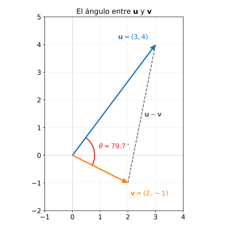
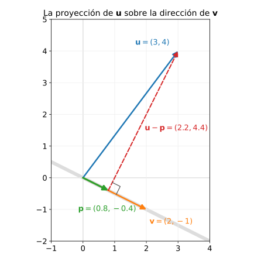
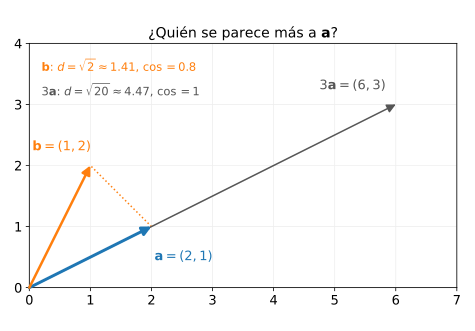

## Objetivos de aprendizaje

Al terminar esta lección podrás:

- **Calcular** el ángulo entre dos vectores con $\cos\theta = \mathbf{u} \cdot \mathbf{v} / (\|\mathbf{u}\|\,\|\mathbf{v}\|)$, **leer** del signo de $\mathbf{u} \cdot \mathbf{v}$ si es agudo, recto u obtuso, y **reconocer** vectores ortogonales. *(Aplicar)*
- **Calcular** similitudes coseno entre vectores de datos (conteos de palabras, calificaciones) a mano y con NumPy, y la proyección de un vector sobre una dirección unitaria. *(Aplicar)*
- **Demostrar** la desigualdad de Cauchy-Schwarz y la desigualdad triangular para $\ell_2$, y **deducir** que $-1 \le \cos\theta \le 1$. *(Analizar)*
- **Evaluar** cuándo la similitud coseno y la distancia euclidiana no coinciden sobre cuál vector se parece más, y **escoger** la que responde una pregunta. *(Evaluar)*

> **Dónde encaja:** la L02 midió longitudes y distancias. Esta lección mide ángulos con el mismo
> producto punto, demuestra la desigualdad triangular que la L02 enunció, y muestra que "el más
> parecido" depende de si se compara la longitud o solo la dirección. La L04 aplica el coseno a
> columnas centradas: eso es la correlación.

> **Práctica:** [Lab — Ángulo y similitud coseno](l03_lab_angulo_coseno.md) ·
> [](https://colab.research.google.com/github///blob//u01_vectores/l03_lab_angulo_coseno.ipynb) ·
> [Ejercicios resueltos](l03_exercises_angulo_coseno.qmd)

> **En clase y después.** La clase recorre las secciones de la 1 a la 6. Lo marcado **Para leer
> después** amplía la lección; léelo antes del laboratorio. Los errores comunes y los ejercicios
> son para repasar.

## Por qué importa

En la L01 un texto se volvió un vector de conteos de palabras. Toma un texto y el mismo texto
escrito tres veces: dicen lo mismo, pero la distancia entre sus vectores es **mayor** que la
distancia a un texto sobre otro tema. La distancia ve que un vector es tres veces más largo; no
ve que los dos apuntan en la misma dirección. El **ángulo** entre los vectores sí lo ve. En CDAT
4001 calculaste similitudes coseno; esta lección dice de dónde sale la fórmula, por qué su valor
nunca pasa de 1 y cuándo responde mejor que una distancia a la pregunta "¿cuál se parece más?".

## 1. El ángulo entre dos vectores

Dos flechas que salen del origen forman un triángulo con el lado $\mathbf{u} - \mathbf{v}$
(figura 1). La **ley de los cosenos** (*law of cosines*), de precálculo, relaciona los tres
lados con el ángulo $\theta$ entre $\mathbf{u}$ y $\mathbf{v}$:

$$
\|\mathbf{u} - \mathbf{v}\|^2 = \|\mathbf{u}\|^2 + \|\mathbf{v}\|^2 - 2\,\|\mathbf{u}\|\,\|\mathbf{v}\| \cos\theta .
$$

El mismo lado se puede desarrollar con las propiedades del producto punto de la L02, como en su
Ejercicio 3:

$$
\|\mathbf{u} - \mathbf{v}\|^2 = (\mathbf{u} - \mathbf{v}) \cdot (\mathbf{u} - \mathbf{v})
= \|\mathbf{u}\|^2 - 2\,\mathbf{u} \cdot \mathbf{v} + \|\mathbf{v}\|^2 .
$$

Las dos expresiones son iguales; al quitar lo que tienen en común queda
$\mathbf{u} \cdot \mathbf{v} = \|\mathbf{u}\|\,\|\mathbf{v}\| \cos\theta$. Así que, para vectores
no nulos, el **ángulo** (*angle*) entre ellos cumple

$$
\cos\theta = \frac{\mathbf{u} \cdot \mathbf{v}}{\|\mathbf{u}\|\,\|\mathbf{v}\|},
\qquad 0^\circ \le \theta \le 180^\circ .
$$

**Ejemplo.** Con $\mathbf{u} = (3, 4)$ y $\mathbf{v} = (2, -1)$, los vectores de la L02:
$\mathbf{u} \cdot \mathbf{v} = 2$, $\|\mathbf{u}\| = 5$ y $\|\mathbf{v}\| = \sqrt{5}$.

$$
\begin{aligned}
\cos\theta &= \frac{2}{5\sqrt{5}} \\
&\approx 0.179
\end{aligned}
$$

$$
\begin{aligned}
\theta &= \arccos\left(\frac{2}{5\sqrt{5}}\right) \\
&\approx 79.7^\circ
\end{aligned}
$$

{#fig-angulo width="55%" fig-alt="En el plano, una flecha azul del origen a u = (3, 4) y una flecha naranja del origen a v = (2, -1). Un arco rojo entre las dos flechas marca el ángulo theta, aproximadamente 79.7 grados. Una línea gris discontinua une las puntas de las flechas: es el lado u - v del triángulo."}

**Cómo leer la figura.** El arco rojo es el ángulo $\theta$; la línea discontinua, el tercer
lado del triángulo, $\mathbf{u} - \mathbf{v}$. En $\mathbb{R}^2$ y $\mathbb{R}^3$ el ángulo se
puede medir con un transportador. En $\mathbb{R}^n$ ya no hay dibujo, y la fórmula se toma como
**definición** del ángulo. Para que defina algo, el cociente tiene que estar entre $-1$ y $1$:
eso es lo que garantiza la sección 3.

## 2. El signo del producto punto

Las normas son positivas, así que $\cos\theta$ tiene el signo de $\mathbf{u} \cdot \mathbf{v}$:

| $\mathbf{u} \cdot \mathbf{v}$ | $\cos\theta$ | El ángulo |
|---|---|---|
| positivo | positivo | agudo, menor que $90^\circ$ |
| cero | cero | recto, $90^\circ$ |
| negativo | negativo | obtuso, mayor que $90^\circ$ |

Dos vectores con $\mathbf{u} \cdot \mathbf{v} = 0$ son **ortogonales** (*orthogonal*):
perpendiculares, en el dibujo. Como $\mathbf{0} \cdot \mathbf{v} = 0$, el vector cero es
ortogonal a todos.

**Ejemplos.** $(1, 0) \cdot (1, 1) = 1$: agudo, y en efecto el ángulo es $45^\circ$.
$(2, 1) \cdot (-1, 2) = -2 + 2 = 0$: ortogonales. $(1, 2) \cdot (-3, 1) = -3 + 2 = -1$: obtuso,
de unos $98.1^\circ$. Para saber el **tipo** de ángulo basta el signo; las normas solo hacen
falta para saber **cuánto** mide.

## 3. Proyección y la desigualdad de Cauchy-Schwarz

**La proyección sobre una dirección.** Sea $\mathbf{w}$ un vector unitario (L02). La componente
de $\mathbf{u}$ en la dirección de $\mathbf{w}$ es el número $\mathbf{u} \cdot \mathbf{w}$, y la
**proyección** (*projection*) de $\mathbf{u}$ sobre esa dirección es el vector

$$
\mathbf{p} = (\mathbf{u} \cdot \mathbf{w})\,\mathbf{w} .
$$

Lo que sobra, $\mathbf{u} - \mathbf{p}$, es ortogonal a $\mathbf{w}$:
$(\mathbf{u} - \mathbf{p}) \cdot \mathbf{w} = \mathbf{u} \cdot \mathbf{w} -
(\mathbf{u} \cdot \mathbf{w})(\mathbf{w} \cdot \mathbf{w}) = 0$, porque
$\mathbf{w} \cdot \mathbf{w} = \|\mathbf{w}\|^2 = 1$.

**Ejemplo.** Con $\mathbf{u} = (3, 4)$ y la dirección de $\mathbf{v} = (2, -1)$, el vector
unitario es $\mathbf{w} = \frac{1}{\sqrt{5}}(2, -1)$ y la componente es
$\mathbf{u} \cdot \mathbf{w} = \frac{2}{\sqrt{5}} \approx 0.894$. La proyección es

$$
\begin{aligned}
\frac{2}{\sqrt{5}} \cdot \frac{1}{\sqrt{5}}(2, -1) &= \frac{2}{5}(2, -1) \\
&= (0.8, -0.4)
\end{aligned}
$$

y lo que sobra, $\mathbf{u} - \mathbf{p} = (2.2, 4.4)$, es ortogonal a $\mathbf{v}$:

$$
\begin{aligned}
(2.2)(2) + (4.4)(-1) &= 4.4 - 4.4 \\
&= 0
\end{aligned}
$$

{#fig-proyeccion width="55%" fig-alt="En el plano, una franja gris marca la recta que pasa por el origen en la dirección de v = (2, -1), dibujado en naranja. La flecha azul u = (3, 4) sale del origen. Una flecha verde corta, del origen a p = (0.8, -0.4), está sobre la recta. Una flecha roja discontinua va de p a la punta de u: es u - p = (2.2, 4.4), y un pequeño cuadro en p marca que forma un ángulo recto con la recta."}

**Cómo leer la figura.** La proyección $\mathbf{p}$, en verde, es la sombra de $\mathbf{u}$
sobre la recta de $\mathbf{v}$. La flecha roja, $\mathbf{u} - \mathbf{p}$, cae perpendicular a
esa recta. Un triángulo rectángulo: la hipotenusa $\mathbf{u}$ es más larga que cada cateto.

**La desigualdad de Cauchy-Schwarz** (*Cauchy-Schwarz inequality*). Para todos los vectores
$\mathbf{u}, \mathbf{v}$ de $\mathbb{R}^n$,

$$
|\mathbf{u} \cdot \mathbf{v}| \le \|\mathbf{u}\|\,\|\mathbf{v}\| .
$$

*Demostración.* Si $\mathbf{v} = \mathbf{0}$, los dos lados valen 0. Si no, sea
$\mathbf{w} = \mathbf{v}/\|\mathbf{v}\|$ y $\mathbf{p} = (\mathbf{u} \cdot \mathbf{w})\,\mathbf{w}$.
La norma de lo que sobra no es negativa, y se desarrolla con las propiedades del producto punto
(usando $\mathbf{w} \cdot \mathbf{w} = 1$):

$$
0 \le \|\mathbf{u} - \mathbf{p}\|^2
= \|\mathbf{u}\|^2 - 2(\mathbf{u} \cdot \mathbf{w})^2 + (\mathbf{u} \cdot \mathbf{w})^2
= \|\mathbf{u}\|^2 - (\mathbf{u} \cdot \mathbf{w})^2 .
$$

Así que $(\mathbf{u} \cdot \mathbf{w})^2 \le \|\mathbf{u}\|^2$. Como
$\mathbf{u} \cdot \mathbf{w} = \mathbf{u} \cdot \mathbf{v} / \|\mathbf{v}\|$, multiplicando por
$\|\mathbf{v}\|^2$ queda $(\mathbf{u} \cdot \mathbf{v})^2 \le \|\mathbf{u}\|^2\,\|\mathbf{v}\|^2$,
y la raíz cuadrada da la desigualdad. $\square$

En el ejemplo: $\|\mathbf{u} - \mathbf{p}\|^2 = 2.2^2 + 4.4^2 = 24.2$, que es
$\|\mathbf{u}\|^2 - (\mathbf{u} \cdot \mathbf{w})^2 = 25 - \frac{4}{5}$, y
$|\mathbf{u} \cdot \mathbf{v}| = 2 \le 5\sqrt{5} \approx 11.18$.

**El coseno está entre $-1$ y $1$.** Al dividir Cauchy-Schwarz entre
$\|\mathbf{u}\|\,\|\mathbf{v}\|$ (vectores no nulos):

$$
-1 \le \frac{\mathbf{u} \cdot \mathbf{v}}{\|\mathbf{u}\|\,\|\mathbf{v}\|} \le 1 .
$$

Ahora sí la fórmula de la sección 1 define un ángulo en cualquier $\mathbb{R}^n$. Si una cuenta
da un coseno mayor que 1, hay un error de aritmética.

## 4. La desigualdad triangular para $\ell_2$

La L02 enunció la **desigualdad triangular** (*triangle inequality*),
$\|\mathbf{u} + \mathbf{v}\| \le \|\mathbf{u}\| + \|\mathbf{v}\|$, y la demostró para $\ell_1$.
Para $\ell_2$, Cauchy-Schwarz hace el trabajo:

$$
\begin{aligned}
\|\mathbf{u} + \mathbf{v}\|^2 &= \|\mathbf{u}\|^2 + 2\,\mathbf{u} \cdot \mathbf{v} + \|\mathbf{v}\|^2 && \text{propiedades del producto punto} \\
&\le \|\mathbf{u}\|^2 + 2\,\|\mathbf{u}\|\,\|\mathbf{v}\| + \|\mathbf{v}\|^2 && \text{Cauchy-Schwarz} \\
&= (\|\mathbf{u}\| + \|\mathbf{v}\|)^2 && \text{el cuadrado de una suma}
\end{aligned}
$$

Los dos lados, $\|\mathbf{u} + \mathbf{v}\|$ y $\|\mathbf{u}\| + \|\mathbf{v}\|$, no son
negativos, así que la raíz cuadrada conserva la desigualdad:
$\|\mathbf{u} + \mathbf{v}\| \le \|\mathbf{u}\| + \|\mathbf{v}\|$. $\square$ El segundo paso usa
$\mathbf{u} \cdot \mathbf{v} \le |\mathbf{u} \cdot \mathbf{v}| \le \|\mathbf{u}\|\,\|\mathbf{v}\|$.
Con los vectores de la L02, $\|\mathbf{u} + \mathbf{v}\| = \sqrt{34} \approx 5.83$ y
$\|\mathbf{u}\| + \|\mathbf{v}\| = 5 + \sqrt{5} \approx 7.24$.

## 5. Similitud coseno

La **similitud coseno** (*cosine similarity*) de dos vectores no nulos es el coseno del ángulo
entre ellos, $\mathbf{u} \cdot \mathbf{v} / (\|\mathbf{u}\|\,\|\mathbf{v}\|)$. Mide si apuntan en
la misma dirección, sin mirar cuánto miden: para un escalar $c > 0$, el vector $c\,\mathbf{u}$
tiene la misma similitud coseno con $\mathbf{v}$ que $\mathbf{u}$ (lo demuestras en los
ejercicios).

{#fig-coseno width="65%" fig-alt="En el plano, la flecha azul a = (2, 1), la flecha naranja b = (1, 2) y una flecha gris más larga, 3a = (6, 3), en la misma dirección que a. Una línea punteada naranja une las puntas de a y b. Un texto dice: b, distancia raíz de 2, aproximadamente 1.41, coseno 0.8; 3a, distancia raíz de 20, aproximadamente 4.47, coseno 1."}

**Cómo leer la figura.** ¿Quién se parece más a $\mathbf{a} = (2, 1)$? Por distancia,
$\mathbf{b} = (1, 2)$: está a $\sqrt{2} \approx 1.41$, y $3\mathbf{a}$ está a
$\sqrt{20} \approx 4.47$. Por ángulo, $3\mathbf{a}$: apunta en la misma dirección (coseno 1),
mientras que $\mathbf{b}$ forma un ángulo con coseno $\frac{4}{5} = 0.8$. Las dos respuestas son
correctas; responden preguntas distintas.

**Con textos.** Con el vocabulario de la L01 ("vector", "datos", "matriz", "suma"), el texto
"una matriz de datos tiene un vector de datos por fila" es $\mathbf{x}_1 = (1, 2, 1, 0)$ y "la
suma de un vector y otro vector es un vector" es $\mathbf{x}_2 = (3, 0, 0, 1)$. Su similitud
coseno es

$$
\begin{aligned}
\frac{1(3) + 2(0) + 1(0) + 0(1)}{\sqrt{6}\,\sqrt{10}} &= \frac{3}{\sqrt{60}} \\
&\approx 0.387
\end{aligned}
$$

El primer texto escrito tres veces es $3\mathbf{x}_1 = (3, 6, 3, 0)$: coseno 1 con
$\mathbf{x}_1$, aunque la distancia entre ellos, $\|2\mathbf{x}_1\| = \sqrt{24} \approx 4.90$,
es mayor que la distancia entre $\mathbf{x}_1$ y $\mathbf{x}_2$, $\sqrt{10} \approx 3.16$.

Los conteos no son negativos, así que su producto punto tampoco: la similitud coseno de dos
textos está entre 0 y 1. Vale 0 exactamente cuando no comparten ninguna palabra del vocabulario,
porque cada producto $x_i y_i$ es 0. Entre conteos, "ortogonales" quiere decir "sin nada en
común".

## 6. Usuarios de MovieLens: ¿quién se parece a quién?

MovieLens es un servicio que recomienda películas. El curso trae una parte de sus datos: las
calificaciones (de 0.5 a 5 estrellas) de 413 usuarios a las 20 películas con más
calificaciones, como una matriz de datos $R$ de $413 \times 20$; un 0 quiere decir que el
usuario no calificó esa película. Cada usuario es un vector de $\mathbb{R}^{20}$. ¿Quién se
parece más al usuario 308? En el laboratorio lo calculas así. `O` tiene una fila por cada uno de
los otros 412 usuarios, y `r` es el vector del 308. `O * r` multiplica cada fila por `r`,
componente a componente (la difusión de la L02), y `.sum(axis=1)` suma cada fila: sale el
producto punto de cada usuario con `r`.

```python
productos = (O * r).sum(axis=1)                  # el producto punto de cada fila con r
cosenos = productos / (np.linalg.norm(O, axis=1) * np.linalg.norm(r))
distancias = np.linalg.norm(O - r, axis=1)
```

~~~text
el usuario 308 califico 12 peliculas; norma 7.18
por coseno: usuario 246 | califico 10 | en comun con 308: 8
   coseno 0.842 | distancia 8.85 | norma 13.99
por distancia: usuario 10 | califico 6 | en comun con 308: 4
   coseno 0.616 | distancia 5.77 | norma 5.55
~~~

Por coseno, el más parecido es el usuario 246, que calificó 8 de las 12 películas del 308. Por
distancia, el más cercano es el usuario 10: calificó solo 6 películas, comparte 4, y su vector
es el más corto de los 413. El usuario 308 reparte pocas estrellas (de 0.5 a 3.5), así que su
vector también es corto, y la distancia escoge a otro vector corto.

**El control: todos los usuarios.** Con la misma cuenta para cada uno de los 413 usuarios, las
dos medidas escogen a alguien distinto para 152 de ellos. En esos casos, el usuario que escoge la
distancia tiene un vector **más corto** que el que escoge el coseno 144 veces, y más largo solo 8.
La distancia se inclina por los vectores cortos; la similitud coseno no mira la longitud.

**Lo que esto no dice.** Ninguna de las dos es "la correcta": la distancia responde "¿quién
reparte estrellas como el 308?", y el coseno, "¿a quién le gustan las mismas películas, en la
misma proporción?". Además, aquí un 0 quiere decir "no la calificó", no "cero estrellas", y
ninguna de las dos medidas sabe distinguirlo: el coseno también premia haber visto las mismas
películas. Tratar bien los datos que faltan es otro tema.

## Para leer después

**Cuándo hay igualdad en Cauchy-Schwarz.** Si $\mathbf{v} = c\,\mathbf{u}$, entonces
$|\mathbf{u} \cdot \mathbf{v}| = |c|\,\|\mathbf{u}\|^2 = \|\mathbf{u}\|\,\|\mathbf{v}\|$: hay
igualdad. Al revés, la demostración muestra que la igualdad obliga a
$\|\mathbf{u} - \mathbf{p}\| = 0$, es decir, $\mathbf{u} = \mathbf{p}$, un múltiplo de
$\mathbf{v}$. Así que $|\cos\theta| = 1$ solo cuando los vectores son paralelos: $\theta = 0^\circ$
si apuntan igual, $180^\circ$ si apuntan en sentidos opuestos.

**El ángulo con NumPy.**

- `np.arccos(c)` devuelve el ángulo cuyo coseno es `c`, **en radianes**, entre $0$ y $\pi$;
  `np.degrees` lo pasa a grados.
- La similitud coseno de dos vectores es
  `np.dot(u, v) / (np.linalg.norm(u) * np.linalg.norm(v))`.
- Con `w` unitario, `u @ w` es la componente de `u` en la dirección de `w`, y `(u @ w) * w` es
  la proyección.
- `(O * r).sum(axis=1)`, de la sección 6, da el producto punto de cada fila de `O` con `r`.

## Errores comunes

- **Leer radianes como grados.** $\arccos\left(\frac{2}{5\sqrt{5}}\right) \approx 1.39$ es el
  ángulo en radianes; en grados es $79.7^\circ$.
- **Dividir entre $\|\mathbf{u}\|^2$.** El denominador es el producto de las **dos** normas,
  $\|\mathbf{u}\|\,\|\mathbf{v}\|$.
- **Un coseno mayor que 1.** Cauchy-Schwarz lo prohíbe: hay un error en la cuenta.
- **Pensar que coseno 1 quiere decir vectores iguales.** Quiere decir la misma dirección:
  $(2, 1)$ y $(6, 3)$ tienen coseno 1 y están a $\sqrt{20}$ de distancia.
- **Buscar el ángulo del vector cero.** $\mathbf{0}$ no tiene dirección; la fórmula divide entre
  $\|\mathbf{0}\| = 0$.

## Pregunta frecuente

**¿Coseno o distancia?** Depende de la pregunta. Si el tamaño importa (cuánto compra un cliente,
cuántas estrellas reparte un usuario), la distancia. Si solo importa la proporción entre las
componentes (de qué trata un texto, qué películas le gustan a alguien), el coseno. En los
ejercicios hay preguntas sobre los mismos vectores donde cada una da otra respuesta.

## Ejercicios

- La [página de ejercicios](l03_exercises_angulo_coseno.qmd) tiene ángulos, similitudes coseno
  y proyecciones resueltos paso a paso, tres de ellos con un modo guiado, las demostraciones de
  Cauchy-Schwarz y de la desigualdad triangular, y una sección para escoger entre coseno y
  distancia.
- En el [laboratorio](l03_lab_angulo_coseno.md) calculas ángulos con NumPy, comparas textos y
  buscas al usuario de MovieLens más parecido por coseno y por distancia.

## Resumen

| Notación | Qué significa | NumPy |
|---|---|---|
| $\cos\theta = \dfrac{\mathbf{u} \cdot \mathbf{v}}{\|\mathbf{u}\|\,\|\mathbf{v}\|}$ | el ángulo entre dos vectores no nulos, de $0^\circ$ a $180^\circ$ | `np.degrees(np.arccos(c))` |
| $\mathbf{u} \cdot \mathbf{v} = 0$ | vectores ortogonales: ángulo recto; entre conteos, nada en común | `np.dot(u, v)` |
| $(\mathbf{u} \cdot \mathbf{w})\,\mathbf{w}$, con $\|\mathbf{w}\| = 1$ | la proyección de $\mathbf{u}$ sobre la dirección de $\mathbf{w}$ | `(u @ w) * w` |
| $\lvert \mathbf{u} \cdot \mathbf{v} \rvert \le \|\mathbf{u}\|\,\|\mathbf{v}\|$ | Cauchy-Schwarz: el coseno está entre $-1$ y $1$ | |
| $\|\mathbf{u} + \mathbf{v}\| \le \|\mathbf{u}\| + \|\mathbf{v}\|$ | la desigualdad triangular, demostrada con Cauchy-Schwarz | |
| similitud coseno | compara direcciones, no longitudes | `(O * r).sum(axis=1) / (np.linalg.norm(O, axis=1) * np.linalg.norm(r))` |

## Ideas clave

- El ángulo $\theta$ entre $\mathbf{u}$ y $\mathbf{v}$ cumple $\cos\theta = \dfrac{\mathbf{u} \cdot \mathbf{v}}{\|\mathbf{u}\|\,\|\mathbf{v}\|}$, y el signo de $\mathbf{u} \cdot \mathbf{v}$ dice si el ángulo es agudo, recto u obtuso.
- La desigualdad de Cauchy-Schwarz, $|\mathbf{u} \cdot \mathbf{v}| \le \|\mathbf{u}\|\,\|\mathbf{v}\|$, garantiza que el coseno está entre $-1$ y $1$; de ella sale la desigualdad triangular $\|\mathbf{u} + \mathbf{v}\| \le \|\mathbf{u}\| + \|\mathbf{v}\|$.
- La similitud coseno compara la dirección de dos vectores y no su longitud: un texto y el mismo texto repetido tienen similitud 1, aunque la distancia entre ellos sea grande.

## Lecturas adicionales

- **Texto del curso:** Boyd y Vandenberghe, *Introduction to Applied Linear Algebra*, sección 3.4
  (ángulo, desigualdad de Cauchy-Schwarz). Gratis en el sitio de los autores.
- **Texto del curso:** Lay, Lay y McDonald, *Álgebra lineal y sus aplicaciones*, secciones 6.1 y
  6.2 (ortogonalidad, proyección).
- **Datos:** F. Maxwell Harper y Joseph A. Konstan (2015), *The MovieLens Datasets: History and
  Context*, ACM Transactions on Interactive Intelligent Systems 5(4). Los datos son de GroupLens
  (Universidad de Minnesota), que no respalda este curso.
- **Documentación:** NumPy, `numpy.arccos` y `numpy.degrees`.
